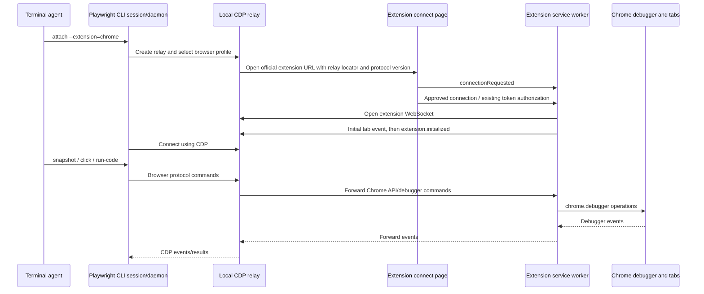
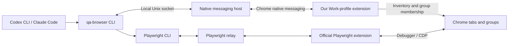

# Work Browser Bridge — research and build plan

Prepared October 28, 2026. Implementation update: the companion extension, native host and CLI prototype now exist in this project root. Twelve tests pass, including real-browser companion/Playwright compatibility. Latch 0.1.1 is installed; its native host and explicit Work-profile pairing passed a direct terminal-only smoke test in the actual browser. Lifecycle recovery remains later work. The rest of this document records the original design and completion gates.

## Outcome

From Codex CLI or Claude Code, an agent can discover an already open work tab, connect it to a named Playwright CLI session, verify the page using the existing login, and release it. After initial installation and authorization, this requires no desktop-control tool, tab dragging, connection-page clicking, or browser restart during normal operation.

Start with macOS and Google Chrome, matching the current machine. The Work and Personal profiles remain separate. Discovery covers ordinary tabs and windows in the paired Work profile; page inspection and automation happen through Playwright after a tab is selected.

## Findings established so far

| Finding | Evidence and status |
| --- | --- |
| Existing authenticated tabs can be controlled through CLI extension attachment | Tested locally against the existing GitHub Issues tab. |
| Grouping an existing tab causes it to appear in the attached CLI session | Tested locally; corroborated by `ConnectedTabGroup` source. |
| Detach → fresh attach → reclaim the same tab works without desktop control | Tested with the temporary `claim-tab.mjs` helper; Chrome tab ID stayed unchanged. |
| A normal CLI session lists its client group, rather than the profile-wide tab inventory | Observed locally. This is not a hard security boundary against privileged extension code. |
| Current helper depends on executing code in the official extension's Welcome page | Tested workaround; remove this dependency from the new implementation. |
| CLI extension mode targets the official extension's fixed ID | Confirmed in the installed package and upstream source. A different extension ID cannot simply replace it. |
| Work-profile pinning and two simultaneous sessions | Not validated yet. They are required compatibility tests. |
| Moving a tab from a separate companion extension triggers the official extension correctly | Supported by the event-driven design, but not yet tested. This is the first implementation gate. |

Baseline: `@playwright/cli` 0.1.20, its `playwright-core` dependency 1.64.0-alpha-2026-09-14, and installed Playwright extension 0.4.0. The inspected installed `coreBundle.js` SHA-256 is `a4fa7fde1714bdf8f7f20689dafd2c6bdcf2577299ee36e712f7f4de210d31d4`.

Upstream HEAD recorded during investigation: `f9a841f968dd9a4e315df2ec2930da1952971667`. This is a research reference, not a claim that the installed alpha package was built from that commit. Before implementation, snapshot the relevant sources at an immutable revision and record the Chrome version too.

## How the current connection works



The CLI uses Playwright's browser factory. Extension mode starts a local relay with two separate WebSocket paths: one for Playwright's CDP connection, another for the extension. The launch URL identifies that relay, the client and the extension protocol version. An optional existing token enables automatic authorization. [Relay implementation](https://github.com/microsoft/playwright/blob/main/packages/playwright-core/src/tools/mcp/cdpRelay.ts), [browser creation](https://github.com/microsoft/playwright/blob/main/packages/playwright-core/src/tools/mcp/extensionContextFactory.ts).

The connect page asks the background worker to record a pending connection. The authorized selection starts the WebSocket. The initial tab is announced before `extension.initialized`, which releases the relay's initialization gate. [Connect page](https://github.com/microsoft/playwright/blob/main/packages/extension/src/ui/connect.tsx), [pending connections](https://github.com/microsoft/playwright/blob/main/packages/extension/src/pendingConnection.ts), [protocol adapter](https://github.com/microsoft/playwright/blob/main/packages/playwright-core/src/tools/mcp/cdpRelayV2.ts).

The background creates a client-specific tab group. Membership changes drive debugger attachment and detachment; groups are functional routing state, not just visual decoration. The relay translates between CDP and the extension's Chrome API command/event protocol. [Group implementation](https://github.com/microsoft/playwright/blob/main/packages/extension/src/connectedTabGroup.ts), [extension transport](https://github.com/microsoft/playwright/blob/main/packages/extension/src/relayConnection.ts), [wire types](https://github.com/microsoft/playwright/blob/main/packages/playwright-core/src/tools/mcp/protocol.ts).

The directory names containing `mcp` are shared Playwright internals. This architecture still uses Playwright CLI; the terminal agents do not need an MCP server configured.

## What we add and what we reuse

| Capability | Owner |
| --- | --- |
| Inventory of Work-profile tabs and windows | Our companion extension |
| Profile pairing, exact tab selection, session ownership and diagnostics | Our local bridge and CLI |
| Programmatic addition/removal of a selected tab from the right client group | Our companion extension |
| Existing relay, debugger/CDP translation, browser interaction | Official Playwright extension and CLI |
| Assertions, screenshots, network/console inspection and QA evidence | Playwright CLI and the calling agent |

Recommended first design: a companion extension alongside the official extension. This gives us an extension we own without reimplementing the debugging transport. The companion will use documented Chrome APIs and a versioned local message protocol. It will not evaluate code inside the official extension's pages.

A complete replacement extension is a separate architecture decision. The installed CLI hardcodes the official ID; we will not impersonate that ID, reuse its manifest key, or silently patch global CLI files. A future independent transport could integrate through the documented `attach --cdp=<endpoint>` route, but implementing a Playwright-compatible CDP bridge is substantial work, not merely forwarding a few debugger commands. If companion compatibility fails, stop and compare that larger project with an upstream change before expanding scope. [Fixed extension ID](https://github.com/microsoft/playwright/blob/main/packages/playwright-core/src/tools/utils/extension.ts), [CLI attachment options](https://playwright.dev/agent-cli/commands/attach).

## Proposed architecture



Use TypeScript for the MV3 companion, Node host, CLI and shared message types. Start without a persistent database; store small pairing/config records and reconstruct live state from Chrome and Playwright. A native messaging host gives Chrome a supported connection to a local process; the terminal reaches that process through a per-user Unix socket. [Chrome native messaging](https://developer.chrome.com/docs/extensions/develop/concepts/native-messaging).

Proposed package boundaries:

```text
packages/extension/             MV3 worker, inventory, group operations, status popup
packages/native-host/           Native framing, local socket, request routing
packages/cli/                   qa-browser commands and Playwright subprocess adapter
packages/protocol/              Validated requests, responses, IDs and errors
tests/integration/              Browser/CLI compatibility and lifecycle scenarios
docs/                          Setup, source map, compatibility matrix, troubleshooting
```

The repository should be created in an explicitly chosen project location during implementation. This planning task does not install extensions, register a native host, or modify agent configuration.

## Session identity: the first design problem to solve

Group titles, the active tab, and the foreground window are unsuitable identifiers. Two clients may both appear as `playwright-cli`.

The proposed adapter will start a named CLI attachment with an explicit Work profile directory. It will capture the CLI's structured connection result privately and correlate the fresh relay locator with the exact official `connect.html` tab observed by our companion. Once that tab is grouped, the companion records the group ID against our own session ID. The token parameter is neither needed for correlation nor emitted in logs.

Registry keys include paired profile instance, browser connection epoch, canonical workspace and logical CLI session. This prevents equal session names in different projects from colliding. Chrome tab/group IDs are treated as browser-session identifiers, never durable identities across restart.

This correlation method is a hypothesis to prove against the installed CLI. Its result shape and connection URL are version-sensitive, so isolate it in the Playwright adapter. If the CLI does not return a usable connection locator, we need an explicit alternative; do not fall back to choosing a group by title or timing.

After registration, group management uses the stored live group identity and Chrome APIs, not a continuously open/evaluated Welcome page. Verify this with the initial page closed while a controlled target remains open. First-connect authorization remains an installation/setup prerequisite.

## Intended commands and behavior

These commands are proposed interfaces, not installed commands:

```bash
qa-browser doctor --profile work --json
qa-browser tabs --profile work --json
qa-browser connect --profile work --session checkout --tab 123 --json
playwright-cli -s=checkout snapshot
qa-browser release --profile work --session checkout --tab 123
qa-browser disconnect --profile work --session checkout
```

`tabs` returns profile instance, tab ID, window ID, URL, title, group and ownership metadata. It does not read every page's DOM, cookies, or storage.

`connect` validates the tab ID against a fresh inventory, pins the browser profile, establishes or reuses the named CLI session, finds its exact group, acquires ownership and groups the target. It waits until the target is visible to Playwright and selects the corresponding CLI page. It reports success only after a page-level check agrees with the requested tab. A redirect or concurrent navigation produces a clear changed-state result; do not silently switch to another matching page.

Exact-URL selection can be added as a convenience, but duplicate matches return candidate IDs and an ambiguity error. The agent can choose from evidence; a human does not need to click a browser picker. `release` and `disconnect` preserve user tabs and existing logins.

## Build phases and completion gates

### 1. Finish the compatibility map

- Pin source references and local runtime versions; record ownership, startup and teardown paths.
- Capture sanitized attach/initialization/group-change traces and structured CLI responses.
- Validate explicit Work-profile directory selection, including when Personal is the foreground profile.
- Confirm workspace/session scoping with commands invoked from two project directories.
- Document minimum permissions and installation/authorization prerequisites.

Done when the observed sequence agrees with the source map and profile selection no longer depends on last-used state. Reading Chrome's Local State was denied on this machine; installation must support explicitly configured profile metadata rather than depend on direct access to protected profile files.

### 2. Prove a separate companion can manage attachment

- Build a minimal unpacked companion using `tabs`, `tabGroups`, `storage` and `nativeMessaging` permissions. Avoid debugger and content-script permissions for this role.
- Establish one native host connection and one CLI request/response path.
- Correlate the exact CLI session to its group using the adapter described above.
- Add an existing tab through our extension, then take a snapshot through unchanged Playwright CLI.
- Create two simultaneous sessions and prove the group mapping remains distinct.
- Repeat after closing the official Welcome page while the target remains connected.

Go/no-go gate: the native host, companion grouping and CLI verification all work without executing code in the official extension, modifying its files, desktop automation or manual tab management. If this gate fails, reassess the transport before building the rest of the product.

### 3. Implement profile pairing and inventory

- Pair a stable extension-instance UUID with alias `work` during initial setup; keep browser connection epochs separate.
- Explicitly configure the Chrome profile directory used for Playwright launch and validate it against the paired companion's observed connection.
- List ordinary work tabs across work windows. Exclude incognito and browser-internal pages by default.
- Return explicit disconnected, profile-mismatch and pairing-needed errors. Never attach to another available profile as a fallback.

Done when personal foreground activity cannot alter discovery or attachment selection. The alias alone is not proof of the Chrome profile directory; validate the pairing during setup.

### 4. Implement ownership and reliable connect/release

- Serialize operations per session and atomically claim each `(profileInstance, browserEpoch, tabId)`.
- Reject another live session's tab. Reject tabs in unrelated user groups in v1 instead of silently reorganizing them.
- Treat successful grouping as pending until CLI target verification succeeds.
- Roll back only this request's changes when verification fails, preserving tabs and their original state where still applicable.
- Make repeat connections idempotent; bound every wait and return structured errors.
- Discover across windows, but keep each session in one window in v1. Reject cross-window claims explicitly. Test moving a fresh anchor-only group into the target window as an optional later improvement; never move existing user tabs between windows silently.

Done when two agents can operate separate tabs and conflict cleanly when requesting the same tab.

### 5. Handle lifecycle and diagnostics

- Reconcile state after extension-worker termination, native-host failure, agent exit, CLI daemon loss and browser restart.
- Mark stale sessions disconnected; revalidate live browser IDs before any mutation.
- Define heartbeat/lease behavior so a briefly idle agent retains its session, while abandoned ownership can be released without closing user tabs.
- Diagnose missing official extension, missing authorization, unsupported versions, stale groups, closed tabs and debugger detachment.
- Test DevTools-open behavior and report observed conflicts rather than assuming it is supported.
- Account for the official extension's own worker restart/group cleanup behavior.

Done when failures produce recoverable terminal errors rather than wrong-target actions or indefinitely hanging requests. Chrome can terminate MV3 workers, so in-memory state is not sufficient. [Worker lifecycle](https://developer.chrome.com/docs/extensions/develop/concepts/service-workers/lifecycle).

### 6. Package the terminal workflow

- Ship a macOS installer/uninstaller for the native host, socket directory and CLI. Resolve an explicit Node executable path rather than depend on Chrome inheriting a terminal's PATH.
- Provide a minimal extension popup for initial pairing, status and disconnect.
- Document initial extension installation and authorization separately from routine terminal usage.
- Add concise Codex/Claude instructions: discover, claim, verify, release, and preserve test evidence.
- Record a version compatibility matrix and a smoke check to run after Playwright/Chrome updates.

Done when a fresh terminal agent can run the same workflow using only installed commands and no knowledge of extension internals.

## Request protocol and access boundary

Use a versioned JSON envelope with `requestId`, operation, paired profile instance, browser epoch and payload. Define operations for status, inventory, session registration, claim, release and disconnect. Validate every envelope and response. CLI output should have stable error codes such as `PROFILE_UNAVAILABLE`, `SESSION_AMBIGUOUS`, `TAB_CHANGED`, `TAB_OWNED`, `UNSUPPORTED_VERSION` and `ATTACH_TIMEOUT`.

Restrict the native host's allowed extension origin to our own extension. Use a per-user socket directory and restrictive file permissions, and identify concurrent profile hosts explicitly. Native messaging stdout carries framed protocol data only; logs go to stderr. Do not expose arbitrary extension evaluation or a generic localhost browser-control HTTP API.

The paired Work profile is the intended access boundary. Group ownership is routing and coordination; the official Playwright extension already has broad privileges within its profile. Log request outcomes without storing connection tokens, cookie values, page bodies or full URLs with sensitive query parameters. Page screenshots and QA evidence are explicit outputs requested during verification.

## Acceptance matrix

| Scenario | Required result |
| --- | --- |
| Personal X window is foreground | Work inventory and attachment still target the paired Work profile. |
| Existing authenticated work tab | Same tab is controlled; no re-login, replacement tab or page reload. |
| New CLI session | Agent discovers and connects with terminal commands only. |
| Two CLI sessions in one project | Distinct groups and tab ownership. |
| Same logical session name in different projects | No cross-project session confusion. |
| Two tabs have the same URL/title | Ambiguity reported; no arbitrary selection. |
| Tab is already owned or in an unrelated user group | Conflict reported without stealing or regrouping. |
| Tab navigates/closes while claiming | Changed/closed result; never substitute a different tab. |
| Target belongs to another work window | Clear v1 limitation; no silent window relocation. |
| Repeated connect | Idempotent success after fresh verification. |
| Welcome page closes after registration | Continue if transport remains healthy; otherwise explicit recoverable failure. |
| Worker/host/CLI exits unexpectedly | Stale ownership reconciled; user tabs preserved. |
| Browser restarts | Old IDs invalidated; reconnect rediscovers before acting. |
| Playwright extension/CLI version changes | Supported smoke check or explicit compatibility error. |
| Ordinary release/disconnect | Debugger access ends as intended; website tabs and logins remain. |

Use local fixture pages for destructive/race/lifecycle tests, and the authorized existing GitHub tab for a read-only signed-in smoke check. Production mutation is not needed to validate this bridge.

## First implementation slice

The first slice is deliberately one vertical path: paired Work extension → native host → `qa-browser tabs` → session correlation → claim one existing tab → Playwright snapshot → release. Its result is a runnable compatibility prototype and evidence for the go/no-go decision, before broader QA reporting or a replacement CDP transport.
