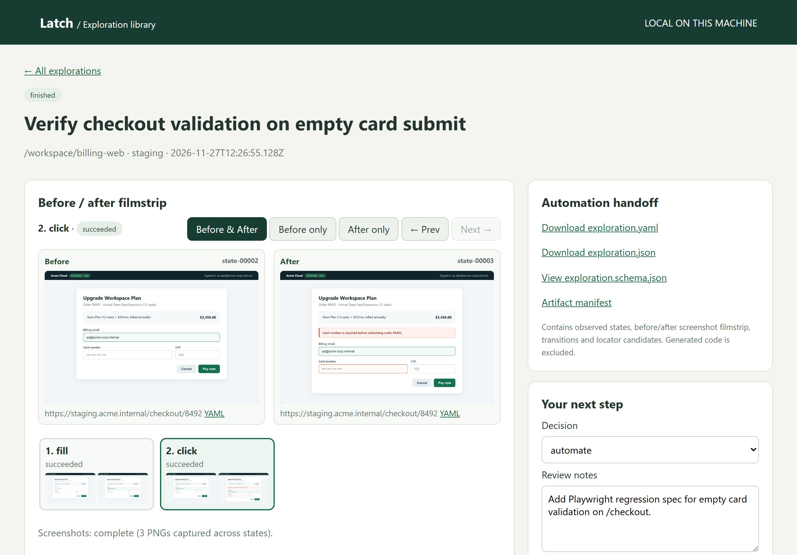

# Latch

**Your signed-in Chrome, built for CLI QA.**

An Apache-2.0 QA browser workbench built for engineers running multiple coding agents from the terminal (**Claude Code**, **Codex**, **Antigravity**, **Cursor**) where there is no built-in IDE browser. Powered by `playwright-core`, Latch drives one authenticated Chrome tab at a time—with zero repo dotfiles, background focus emulation, and a local Exploration Library of before/after PNG filmstrips, observed locators, and triage notes before anything becomes a Playwright test.

**Docs & Showcase:** https://mihaamiharu.github.io/Latch/ · **npm:** `@mihaamiharu/latch` · **Releases:** [v1.0.0](https://github.com/mihaamiharu/Latch/releases/tag/v1.0.0)



## Built for CLI-agent QA workflows

- **Terminal-first across agent subscriptions:** One flat `latch` CLI and compact 3 KB skill (zero MCP tool bloat) works identically whether you're testing with Claude Code, Codex, Antigravity, or Cursor from the CLI.
- **Single-tab safety in your real work Chrome:** Attach to one SSO/MFA-signed-in tab (`latch connect <tabId>`) with per-session ownership locks (`-s <name>`). Other tabs, cookies, and logins stay isolated and untouched on disconnect.
- **Zero repo clutter & background focus:** Session state and large ARIA snapshots (>12 KB) live in OS app data—never dirtying `git status`—while background focus emulation lets agents test without hijacking your cursor.
- **Honest exploratory QA handoff:** Pass `--record` or `--objective` to capture before/after PNG filmstrips, ARIA/DOM locator candidates with ambiguity warnings, and structured checkpoints that separate *observed behavior* from *expected assertions*—reviewed locally at `127.0.0.1` (`automate` / `investigate` / `report_bug` / `closed`).

**Where Latch fits:** Built on `playwright-core` to complement the rest of your stack, not replace it. Use **Playwright** directly for CI test suites and headless runs, **OpenCode Browse** or **Chrome DevTools MCP** for general MCP browsing and browser profiling, and **Latch** for exploratory QA from terminal CLI coding agents in your signed-in work Chrome.

## Prerequisites

- **OS:** Windows, macOS, or Linux
- **Node.js:** `>= 22.0.0`
- **Google Chrome:** `>= 125`
- No external `playwright-cli`, browser downloads, or `ffmpeg` required (`playwright-core` is bundled and drives your existing Chrome).

## Quick start

### Option A: Install via npm

1. Install the CLI globally (uses your existing Chrome—no browser binary downloads):
   ```sh
   npm install -g @mihaamiharu/latch
   ```
2. Register the local bridge and link agent skills/plugins (prints the exact `Extension:` directory to load in Chrome):
   ```sh
   latch install
   ```
3. Load the printed `extension/` folder unpacked in Chrome (`chrome://extensions` → **Developer mode** → **Load unpacked**, fixed ID `dlkpkeiejlgggeoibejpoajedoelfcli`).
4. Pair the running extension and verify health:
   ```sh
   latch pair
   latch doctor
   ```

> **Note:** While a Latch session is attached to a tab, Chrome shows its standard `"Latch" started debugging this browser` banner. It clears automatically on `latch disconnect` or `latch finish`, leaving all tabs and logins intact.

### Option B: Install from a GitHub Release kit or source checkout

1. Download `latch-1.0.0-kit.zip` from Releases and extract it to a permanent folder (or clone the repo and run `npm ci`).
2. Run setup and optionally link `latch` globally:
   ```sh
   node src/cli.mjs install
   npm link   # optional from repo root to expose `latch` globally
   ```
3. Load `extension/` unpacked in Chrome (`chrome://extensions`, Developer mode, fixed ID `dlkpkeiejlgggeoibejpoajedoelfcli`), then run `latch pair`, `latch doctor`, and `latch agents install`.

See [SETUP.md](SETUP.md) for full Windows, macOS, and Linux installation details.

## Flat CLI overview

All commands support global flags `--json`, `-s` / `--session <name>`, `--profile <alias>`, and `--workspace <path>`. `--profile` defaults to the sole/default paired profile, `--workspace` defaults to `cwd`, and active workspace sessions bind cleanly under `<appDataDir>/sessions/` with zero dotfiles added to your repository.

### Session lifecycle & browser actions

```sh
latch tabs
latch open https://staging.example.com
latch snapshot
latch click e3
latch fill e5 "synthetic input"
latch screenshot --out result.png
latch disconnect
```

- **Lifecycle:** `latch tabs`, `latch open <url> [--record] [--objective <text>] [--environment <text>] [--focus-emulation on|off]`, `latch connect [tabId] [...]` (omitting `tabId` attaches to the unowned tab in the Chrome **Latch** tab group), `latch sessions`, `latch release [tabId]`, `latch disconnect`, `latch finish`
- **Actions:** `latch snapshot`, `latch click <ref|selector>`, `latch fill <ref|selector> <value>`, `latch type [ref|selector] <text>`, `latch press <key>`, `latch hover <ref|selector>`, `latch select <ref|selector> <value>`, `latch check <ref|selector>`, `latch uncheck <ref|selector>`, `latch upload <ref|selector> <path...>`, `latch screenshot [--out <path>]`, `latch goto <url>`, `latch back`, `latch forward`, `latch reload`, `latch eval <expr>`, `latch run-code <fn>`, `latch console`, `latch network`, `latch dialog <accept|dismiss> [promptText]`

### Recorded explorations

Pass `--record` or `--objective "<goal>"` on `open` or `connect` to capture before/after PNG screenshot filmstrips, ARIA snapshots, and DOM locator candidates:

```sh
latch open https://staging.example.com/checkout --record --objective "Verify checkout validation"
latch snapshot
latch click e4
latch checkpoint "Submitting empty form shows required-field errors"
latch finish
latch library serve
```

- `latch checkpoint <note> [--annotation-file <path>]`
- `latch library <list|show|serve|review|export|delete> [--run <id>] [--all]` (or use the inline **Delete** buttons in the local Exploration Library UI; active runs are protected until finished or disconnected)
- `latch config <get|set|unset> artifacts-dir [path]` to inspect or customize the Exploration Library storage folder

## Extension popup controls

Click the Latch toolbar icon in Chrome to inspect and control your bridge:

- **Add tab to Latch / Remove from Latch:** Moves the current tab into or out of the green **Latch** Chrome tab group so you can run `latch connect` without copying a `tabId` (`latch open` also auto-groups new tabs and their popups here). Dragging an attached tab out of the **Latch** group immediately detaches automation while keeping the tab and login open.
- **Open Library (`N`):** Lazily starts the local `127.0.0.1` Exploration Library viewer and opens it in a Chrome tab.
- **Agent sessions:** Shows active sessions with attached tab count, **View run** (jumps directly to an active recording in the Library), and **Stop session** (preserves all website tabs and logins).
- **Library & storage:** Collapsible panel showing the active artifacts path, **Choose folder…** (native OS Explorer/Finder/zenity/kdialog folder picker), **Save path**, and **Reset default**.

## Agent plugins & skills

`latch agents <install|status|uninstall> [--target antigravity,claude,codex,cursor]` links Latch into your agent toolchains using directory junctions (Windows) or symlinks (macOS/Linux), never overwriting unrelated user customizations:

| Client | Target path | Source in repo |
| --- | --- | --- |
| Antigravity | `~/.gemini/config/plugins/latch` | `plugins/antigravity/` |
| Claude Code | `~/.claude/skills/latch` | `skills/latch/` (and `.claude-plugin/plugin.json`) |
| Codex / Cursor | `~/.agents/skills/latch` | `skills/latch/` |

## Architecture & key files

| Path | Purpose |
| --- | --- |
| `extension/` | MV3 Chrome extension (`tabs`, `tabGroups`, `storage`, `nativeMessaging`, `alarms`, `debugger`; no website host permissions) |
| `src/native-host.mjs` | Native messaging host, IPC listener, and in-process CDP relay |
| `src/browser-engine.mjs` | Bundled `playwright-core` (`chromium.connectOverCDP`) session & ARIA ref engine |
| `src/platform.mjs` | Cross-platform paths, named pipes / Unix sockets, launchers, and registry/manifest helpers |
| `src/cli.mjs` | Flat `latch` CLI with smart defaults and `--json` output |
| `src/exploration*.mjs` | Unified Exploration Library, before/after screenshot filmstrip, and local review UI |
| `src/agents.mjs` | Native agent plugin & skill installer (`latch agents`) |
| `plugins/antigravity/` | Native Antigravity plugin bundle (`plugin.json`, `rules/AGENTS.md`, `skills/latch/SKILL.md`, `assets/logo.png`) |
| `.claude-plugin/plugin.json` | Claude Code plugin manifest pointing to `skills/` |
| `skills/latch/` | Slim cross-agent `SKILL.md` and `agents/openai.yaml` |

## Build & tests

```sh
npm run build
npm test
```

`npm run build` produces `dist/latch/`, `dist/latch-1.0.0/`, and deterministic release archives in `dist/`. Browser integration tests run headless with disposable profiles per [AGENTS.md](AGENTS.md).

## More documentation

- [SETUP.md](SETUP.md) — cross-platform installation, pairing, and troubleshooting
- [PRIVACY.md](PRIVACY.md) — local transport, redaction, and retention details
- [docs/SUPPORT.md](docs/SUPPORT.md) — supported OS/Node/Chrome matrix
- [docs/EXPLORATION-LIBRARY.md](docs/EXPLORATION-LIBRARY.md) — exploration handoff and local review server
- [docs/DISTRIBUTION.md](docs/DISTRIBUTION.md) — GitHub Releases, npm (`@mihaamiharu/latch`), and Chrome Web Store publishing

## License

Licensed under the [Apache License 2.0](LICENSE). See [THIRD_PARTY_NOTICES.md](THIRD_PARTY_NOTICES.md) for bundled third-party dependencies (`playwright-core`, `ws`).
