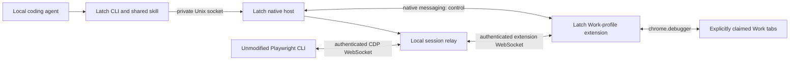

# Latch: one-extension migration plan

Prepared October 28, 2026; status updated October 30. Phases 0–3 are implemented
on `feat/latch-native-transport`, within the Phase 3 declared support matrix.
See `PHASE-3-COMPATIBILITY-PLAN.md` for acceptance and baseline limitations.
Phase 4 recovery is implemented in the native source preview; see
`PHASE-4-RECOVERY-RESULTS.md` for verification and explicit limits. Phase 5 now provides a local release candidate, installer and popup; see
`PHASE-5-INSTALLER-POPUP-RESULTS.md`. RC3 is installed in Work and that profile now
explicitly defaults to native. A local native pilot/two-workspace isolation passed,
and an actual Codex CLI native smoke passed with focus emulation under per-session
Full Access. Restricted execution modes, other clients and remaining live Work
gates are unverified. The earlier RC2 folder migration required an explicitly
approved rebind; full original state preservation remains unverified. See
`PHASE-6-IMPLEMENTATION-RESULTS.md` and `RELEASE-READINESS-2026-10-30.md`.
Unconfigured profiles retain the legacy official default.
`NATIVE-TRANSPORT-CONTRACT.md` and `NATIVE-SESSION-WORKFLOW.md` preserve the
earlier proof and single-tab checkpoint.

## Outcome

Install only Latch in the Work Chrome profile. A local coding agent discovers an existing signed-in tab, connects it to a named session, uses ordinary Playwright CLI commands, captures evidence, and disconnects without closing the user's tabs. Normal operation requires no desktop control, manual tab dragging, browser relaunch, or remote-debugging launch flags.

Latch will own browser attachment as well as profile discovery and agent session ownership. Playwright CLI remains the automation engine for snapshots, locators, actions, assertions and evidence.

Target release: 0.2.0, conditional on the gates below and current release-readiness findings. Retain the owned rollback payloads through release acceptance.

## Starting point and constraints

- Working checkpoint: `ad4819827f0fc994a1df39aed930a2bab8f44972` on `main`.
- Baseline: Latch 0.1.2; Playwright CLI 0.1.20; runtime Node 22.21.1; official extension 0.4.0. The adapter currently rejects other CLI versions.
- Existing native host registration, stable Latch extension ID, profile alias, instance identity and CLI entry point must survive the upgrade.
- The installed CLI's `attach --help` supports `--cdp`. Compatibility was unproven at initial planning; Phases 1–2 subsequently verified the Latch endpoint, normal helper and concurrent sessions in disposable profiles.
- Current automated baseline: 20 checks passed; the optional real-Chrome test was skipped at checkpoint time. Earlier fixture integration and the user's separate Codex CLI application verification are recorded in `TEST-RESULTS.md` with their limitations.
- Scope is macOS and Google Chrome, with one explicitly paired Work profile and multiple concurrent agent sessions. Personal-profile access is excluded.

This migration simplifies browser installation. It does not remove agent sandbox restrictions: the agent still needs permission to use the local control socket and the new loopback data connection. Keep EPERM/EACCES diagnostic distinctions and do not change global agent security settings.

## Architecture decision

Use Latch's existing native connection for control and an authenticated loopback WebSocket relay for automation traffic.



The native host owns the relay lifetime. The Phase 2 implementation keeps it in the same process, with a separate loopback listener and credentials/routes per named session. No new login daemon or background service is needed.

The extension connects outward to a relay endpoint delivered over its native port. The Playwright daemon connects to a different session-specific CDP endpoint. The public Latch command constructs that endpoint internally; users and agents do not copy connection secrets into prompts.

Do not place screenshots and large CDP results on the existing native request path. That path has a 64 KiB local request limit and a 1 MiB framing limit. Keep native messages small and bounded. WebSocket payload limits, flow control and large-result tests are part of the new transport design.

### Why a relay is needed

Chrome's extension debugger API supplies tab-oriented commands and events. Playwright expects a browser CDP connection, including target discovery and session routing. The relay must maintain the mapping between browser tab IDs, CDP target IDs and parent/child sessions. Copying only debugger attach/send calls will not provide that behavior.

The upstream browser model is a useful reference, but must be adapted to Latch's explicit ownership rules. In particular, review browser-level command forwarding rather than assuming a command is confined to a tab because it was sent through that tab.

The existing Playwright extension entry point uses a fixed extension ID. Keep Latch's own ID and use Playwright's CDP attachment path; do not impersonate the official extension or patch a globally installed CLI package.

## Agent-facing contract

Preserve these commands and the canonical shared skill:

```bash
qa-browser doctor --profile work
qa-browser diagnose --profile work
qa-browser tabs --profile work
qa-browser connect --profile work --session issue194 --tab <observed-id> --workspace <project>
playwright-cli -s=issue194 snapshot
playwright-cli -s=issue194 screenshot --filename=<evidence-path>
qa-browser disconnect --profile work --session issue194 --workspace <project>
```

`qa-browser` here denotes the existing launcher or shared-skill forwarding helper; installation must not assume it is globally on PATH. Placeholders above are illustrative.

During migration, add an explicit `--transport native|official` selector to the Latch connection command. Keep the existing default until cutover. After acceptance, default to `native`; `official` is a deliberate rollback choice. Do not switch automatically after a timeout, because an attachment may have partially succeeded.

Retain existing JSON fields where meaningful. Add transport, protocol version and capability information. In native mode, `groupId` may be absent: Chrome groups are visual organization, not the ownership mechanism. Do not require moving an existing tab into another window or group.

Evidence remains task-local under `work/latch/<session>/`, or the caller's requested path. The wrapper, session workspace isolation, reporting format and screenshot/snapshot commands remain compatible.

## Ownership and connection lifecycle

Use explicit states: `requested → reserved → connecting → attached → releasing → closed`; failures become `failed` with a recorded cleanup outcome. A recovered bridge starts a new epoch rather than silently reviving old credentials.

1. Resolve the paired profile and validate the current browser epoch.
2. Reserve the exact observed tab ID for the canonical workspace/session key. Reject a concurrent owner atomically.
3. Create independent, unguessable session credentials and initialize the extension-side transport over the trusted native connection.
4. Establish the target model before exposing it to Playwright. Attach the unmodified CLI through its CDP option.
5. Verify that the CDP target maps to the exact reserved Chrome tab ID. URL/title are secondary checks; two tabs with the same URL must remain distinguishable.
6. Persist only the state needed for reconciliation, with private permissions. Exclude secret endpoint URLs from normal JSON, errors and reports.
7. On disconnect, detach Playwright, revoke credentials, detach owned debugger targets, release ownership and remove this session's state. Preserve existing website tabs and their login data.

Child frames/workers inherit their owning tab's session. A popup belongs to a session only when its opener is already owned and the popup passes the supported URL/profile checks. Explicitly created automation tabs are tracked separately from existing user tabs.

Agent identity is a workspace/session coordination identity, not cryptographic proof of which model is running. A local process with the same user's access and a session credential can exercise that session. Do not promise isolation from arbitrary software running as that user.

Session lifetime follows the persistent Playwright transport, not individual CLI command processes. Do not expire a healthy session simply because no new command arrived. On lost transport, invalidate access promptly and reconcile resources; never replay a click, form submission or other mutation automatically.

## Access boundaries and supported commands

- Bind the relay to `127.0.0.1` on an OS-selected port; do not listen on other interfaces.
- Authenticate both extension and CDP connections, using separate credentials and roles. The extension credential is delivered through native messaging, not an unauthenticated discovery endpoint.
- Validate Host/Origin, route and credential before accepting a connection. Permit the pinned Latch origin on the extension route; reject website-origin requests. Verify how the installed CLI supplies authentication before choosing header versus secret-path transport. If a secret path is required, redact it everywhere.
- Expose only the session's targets and events. Reject unknown/stale target IDs and CDP child session IDs at both relay and extension boundaries.
- Classify root/browser-level methods explicitly: emulate harmless metadata, route supported target-scoped operations, and reject unsupported or profile-wide operations with a clear error. Do not blindly forward `Browser.*`, `Storage.*` or context-management calls through an arbitrary owned tab.
- Reject browser shutdown and profile-wide storage clearing. A target-close command must resolve to an owned target; cleanup never uses it on existing user tabs. Normal authorized test actions may still modify their selected application's data.
- Add `debugger` permission. Determine any additional host/CSP permissions from the working experiment and record why each is needed; do not copy the upstream `<all_urls>` declaration by default.
- Protect the control directory/socket and state files with their existing private modes. Rate-limit unauthenticated handshakes and bound message sizes, pending requests and queues. On overflow, return a clear error and terminate the affected session safely rather than accumulating unbounded memory.

The selected tab remains a powerful capability: browser automation can execute page JavaScript and read data available to that page. Target ownership does not make shared cookies or same-origin storage independent between agents. Document and test the actual limits.

## Delivery sequence and gates

### Phase 0 — Freeze the baseline and protocol contract

Create an implementation branch from the checkpoint when implementation begins. Preserve the 0.1.2 build and document how to rebuild it from its commit. Capture CLI/runtime/browser versions and the existing adapter tests.

Inspect the installed CLI's CDP handshake and choose the minimum supported method set. Record the exact upstream revision for any reused files, their notices, modifications and dependencies. Reference revision inspected for this plan: `f9a841f968dd9a4e315df2ec2930da1952971667`; this is not yet a compatibility-approved implementation source.

**Gate:** a written compatibility contract and repeatable baseline; no installed Work-profile changes.

### Phase 1 — Prove a single-tab connection

Use disposable Chrome for Testing with only the experimental Latch extension installed. Build a minimal native bootstrap, authenticated relay, debugger adapter and browser target model. Adapt the relevant upstream implementation where practical, preserving source/license notices and replacing private Playwright imports with local, tested interfaces.

Keep Node ESM and the existing test runner. Prefer one pinned WebSocket server dependency such as `ws`, with a lockfile, over hand-writing WebSocket framing. The current no-install runtime claim will need updating if that dependency is adopted.

Attach unmodified Playwright CLI 0.1.20 through CDP. Read a fixture's existing authentication marker, get a snapshot, fill/click, capture a screenshot and inspect a console/network fixture. Detach and confirm the original tab and state still exist. Capture a protocol trace with credentials and fixture-sensitive values redacted.

**Gate:** all of these work with the official extension absent and no browser remote-debugging launch flags. If a CLI patch or an unbounded command bridge is required, stop and revise the design before expanding it.

### Phase 2 — Implement agent ownership and command routing

Integrate reservations with the existing profile/workspace/session model. Add target-ID verification, concurrent sessions and deterministic rollback for failed connection stages. Popup ownership is deferred to Phase 3; the implemented Phase 2 preview explicitly supports one tab per session. Validate endpoint authentication and method scope before treating multi-agent operation as supported.

**Gate:** two sessions can operate different tabs; neither can enumerate or command the other's targets. Wrong-profile, stale-epoch and malformed-session requests fail without changing browser state. Same-URL tabs are selected correctly by identity. Existing groups/windows are preserved.

### Phase 3 — Complete the QA verification surface

See [the detailed Phase 3 compatibility plan](PHASE-3-COMPATIBILITY-PLAN.md). Establish a genuine official/native comparison first, then prioritize attributable new tabs and popups. Matching failures are not proof of feature support.

Cover snapshots/locators, assertions, input, navigation, screenshots, relevant console and network inspection, supported file upload/download behavior, popups and cross-origin frames. Record any unsupported commands with explicit errors rather than implying full Chrome CDP compatibility.

Test screenshot/body payloads above 1 MiB on the data channel, with a declared upper bound, and a sustained event burst. Measure baseline versus native attach latency, command latency and memory use on the same fixtures; establish acceptable release limits from those measurements.

**Gate:** the supported verification workflow produces equivalent useful artifacts to the baseline, without leaking secrets or silently truncating evidence.

### Phase 4 — Make failure and recovery explicit

The identity/fencing decisions, host-owned state design, reconciliation
interface, 22-case matrix and execution order are in
[the Phase 4 execution plan](PHASE-4-RECOVERY-PLAN.md).
Measured acceptance is in [the recovery results](PHASE-4-RECOVERY-RESULTS.md).

Exercise extension reload, native host death, CLI daemon death, browser restart, tab close, navigation, debugger detach/DevTools conflict and disconnect during an in-flight operation. Require verified bridge readiness rather than treating the existence of a native port as sufficient proof of health.

On epoch changes, revoke old endpoints and mark old sessions stale. Reconnect the bridge automatically with bounded backoff; require a new explicit session connection after lost automation state. Identify interrupted mutations as outcome-unknown until the page can be inspected. Provide an idempotent reconciliation path for demonstrably abandoned resources, with no PID-only assumption that a lock is safe to remove.

**Gate:** no abandoned debugger access, hanging pending requests or valid old credentials remain after terminal failure. Doctor/diagnose distinguish profile pairing, native readiness, relay readiness, debugger conflicts and caller permission denials.

### Phase 5 — Integrate installer, popup and shared skill

The concrete stages, release decisions and acceptance matrix are in
[the Phase 5 execution plan](PHASE-5-INSTALLER-POPUP-PLAN.md). This phase verifies
the packaged candidate in disposable profiles; installed Work rollout remains
Phase 6.

Update manifest generation/build packaging, local dependency setup, help and version checks. Preserve the Latch ID, native registration and existing profile configuration. Explain Chrome's one-time debugger permission grant during extension upgrade.

The popup should show paired-profile connection, native/relay health, active agent sessions and controlled tabs. Include a local revoke action for a session that detaches automation and preserves its existing tabs. Keep technical details available for troubleshooting.

Update the single canonical skill and its operations reference. Keep Codex, Claude Code and Cursor discovery links, workspace behavior, evidence paths and cleanup guidance consistent. Report actual client validation separately from link/wrapper tests.

**Gate:** a clean local installation and an upgrade from 0.1.2 both work. Packaging contains the required runtime/license material and no local browser fixtures or credentials. Ordinary tasks use the existing skill flow.

### Phase 6 — Verify the installed Work profile and cut over

Concrete execution plan: [Phase 6 Work rollout](PHASE-6-WORK-ROLLOUT-PLAN.md).
[Implementation status](PHASE-6-IMPLEMENTATION-RESULTS.md) records the headless
migration/popup results and pending real-profile gates. The plan sequences the operator-assisted
Work pilot, actual client checks and explicit native-default cutover.

After disposable-profile gates pass, perform the one-time extension update in Work. Disable the official extension for a controlled smoke check; do not uninstall it yet. Use a disposable test case/fixture with the existing signed-in session, capture artifacts, clean up test data and disconnect. Repeat through the actual Codex CLI execution context, then Claude Code; validate Cursor when it is available rather than claiming it from shared paths alone.

**Gate:** evidence proves operation with Latch alone in the intended profile, including while Personal is foreground. No manual attachment step, browser relaunch or global security change was needed. Only then default to native transport and mark the official extension optional/removable.

## Implementation map

| Area | Planned work |
| --- | --- |
| `extension/background.js` | Native readiness handshake, session bootstrap and lifecycle integration. |
| New `extension/debugger-transport.js` | Checked debugger attach/detach/send, event filtering and child-target ownership. |
| `extension/controller.js`, `extension/protocol.js` | Versioned native session operations and explicit reservations independent of Chrome groups. |
| New `src/relay.mjs`, `src/browser-model.mjs` | Authenticated endpoints, target/session mapping and supported CDP behavior. |
| `src/native-host.mjs`, `src/framing.mjs` | Relay lifecycle and bounded bootstrap messages; retain control/data separation. |
| `src/playwright.mjs`, `src/cli.mjs` | Explicit transport choice, CDP attachment, target-ID verification and compatible result fields. |
| `src/state.mjs`, `src/diagnostics.mjs` | Versioned records, stale-session reconciliation and layered health diagnostics. |
| `src/install.mjs`, `src/build.mjs`, package files | Permission/update handling, pinned dependencies, reproducible packaging. |
| `extension/popup.*`, `skills/latch/`, docs | Session visibility/revoke, agent instructions, evidence and support boundaries. |
| New tests and fixtures | Relay/auth/routing/lifecycle tests and a real-browser suite with no official extension. |

File names are proposed boundaries, not a requirement to create empty scaffolding before the compatibility experiment.

## Release evidence matrix

| Check | Required evidence |
| --- | --- |
| Only Latch installed in fixture profile | Extension inventory plus successful unmodified CLI attachment. |
| Existing authentication preserved | Fixture marker observed before/after connection without exporting credentials. |
| Exact tab selection | Two same-URL tabs with distinct markers; only the chosen tab changes. |
| Concurrent agents | Positive independent actions and rejected cross-session enumeration/commands. |
| Endpoint access | Missing/wrong/expired credentials and website-origin connections rejected. |
| Profile boundary | Work-only inventory; Personal foreground has no effect on pairing or actions. |
| Windows/groups | Tabs in separate windows and existing groups retain placement. |
| Frames/popups/navigation | Correct ownership and routing across redirects, OOPIFs and allowed child tabs. |
| Evidence | Readable screenshots/snapshots, console/network fixtures and large-result checks. |
| Destructive/global CDP | Unsupported shutdown/storage/context operations rejected; target close cannot escape ownership. |
| Lifecycle | Failure-injection results, credential revocation, diagnostic codes and reconciliation outcomes. |
| Cleanup/rollback | Existing tabs and logins preserved; old mode can be restored without stealing live sessions. |
| Real agent execution | Client/version, caller permissions, evidence paths and actual result recorded per tested client. |

## Rollback and completion

Keep the 0.1.2 checkpoint, build procedure and old adapter until cutover is accepted. Session records must include schema/transport versions; older code must reject unfamiliar state rather than interpreting it as its own.

To roll back: stop/revoke the affected native sessions, restore the baseline build or choose the explicit official adapter, enable the official extension, reload Latch if its build changed, and run doctor plus a read-only fixture smoke check. Preserve profile pairing and unrelated browser state. Never move an active session between transports automatically.

The migration is complete when all required gates pass and a fresh machine/profile setup needs only the Latch extension plus its local runtime and Playwright CLI. A successful debugger attach by itself is not completion.

Excluded from this release: cloud/remote browser access, cross-user access, mobile browsers, Firefox/Safari, automated mutation replay, a new automation command language, and rewriting Playwright's snapshots/locators/test engine. Browser-wide tracing/video and other advanced capabilities need explicit compatibility assessment before being advertised.

## Source references

These are implementation research references, not proof that the proposed Latch transport already works.

- [Playwright CLI](https://github.com/microsoft/playwright-cli): CDP attachment is also confirmed by the installed 0.1.20 CLI help.
- [Fixed official extension identity](https://github.com/microsoft/playwright/blob/f9a841f968dd9a4e315df2ec2930da1952971667/packages/playwright-core/src/tools/utils/extension.ts).
- [Extension relay implementation](https://github.com/microsoft/playwright/blob/f9a841f968dd9a4e315df2ec2930da1952971667/packages/extension/src/relayConnection.ts).
- [Browser target model](https://github.com/microsoft/playwright/blob/f9a841f968dd9a4e315df2ec2930da1952971667/packages/playwright-core/src/tools/mcp/browserModel.ts) and [protocol adapter](https://github.com/microsoft/playwright/blob/f9a841f968dd9a4e315df2ec2930da1952971667/packages/playwright-core/src/tools/mcp/cdpRelayV2.ts).
- [Chrome debugger API](https://developer.chrome.com/docs/extensions/reference/api/debugger): permission, target routing and lifecycle constraints.
- [Chrome native messaging](https://developer.chrome.com/docs/extensions/develop/concepts/native-messaging): process/port lifecycle and message size limits.

Next implementation action: Phase 0 and the single-tab Phase 1 experiment. Do not begin replacing the installed Work extension before that experiment passes.
